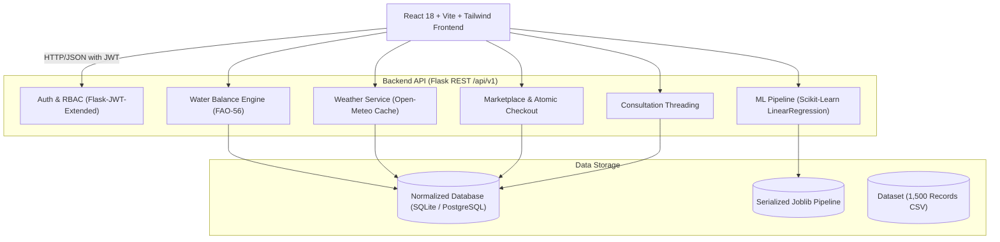
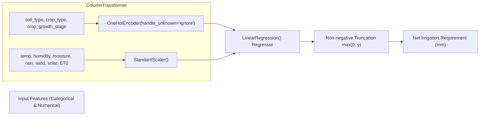

# Smart Irrigation Architecture & Technical Design

This document describes the architectural layers, database models, ML pipeline, and security design of the **Smart Irrigation & Agriculture Lifecycle Management Platform**.

---

## 1. High-Level System Architecture

---

## 2. Machine Learning Pipeline Architecture

The continuous irrigation prediction problem uses a scikit-learn pipeline:

### Model Performance Metrics (Held-Out Test Set):
- **Algorithm**: Ordinary Least Squares Linear Regression with Preprocessing Pipeline
- **Dataset Size**: 1,500 agronomically modeled records
- **Train / Test Split**: 80% (1,200 rows) / 20% (300 rows) with random seed = 42
- **Mean Absolute Error (MAE)**: 1.78 mm
- **Root Mean Squared Error (RMSE)**: 2.76 mm
- **$R^2$ Score**: ~0.70

---

## 3. Database Entity Relationship (ER) Summary

The database is designed with normalized tables adhering to 3NF:
- **`users`**: Core user accounts (email, password_hash, role, phone).
- **`farmer_profiles`**, **`specialist_profiles`**, **`retailer_profiles`**: Role-specific polymorphic profile tables.
- **`farms`** & **`farm_plots`**: Multi-plot farm hierarchies with geolocation coordinates and soil classifications.
- **`crop_references`**: Agronomic parameters ($K_c$ stages, temperature windows, rooting depth, irrigation method).
- **`irrigation_predictions`**: Complete audit snapshot of input weather/soil data, ML predictions, and gross irrigation calculations.
- **`consultations`** & **`consultation_messages`**: Threaded Q&A with specialist diagnostic badges and feedback ratings.
- **`products`**, **`carts`**, **`cart_items`**, **`orders`**, **`order_items`**: Complete e-commerce loop with transactional stock validation.
- **`quotation_requests`** & **`quotations`**: Farmer bulk RFQ bidding system.
- **`audit_logs`**: System audit trail tracking sensitive actions.

---

## 4. Security & Reliability

1. **Password Security**: Werkzeug `generate_password_hash` using salted SHA-256.
2. **Stateless JWT**: Standard Bearer authorization header with 7-day token expiration.
3. **Role-Based Access Control**: Backend `@role_required` decorator checks role on every sensitive endpoint.
4. **Atomic Transactions**: All marketplace order creations execute within database transactions (`db.session.rollback()` upon insufficient stock).
5. **CORS & Input Validation**: Strict validation prevents physically unrealistic measurements (e.g. negative rainfall or moisture > 100%).
